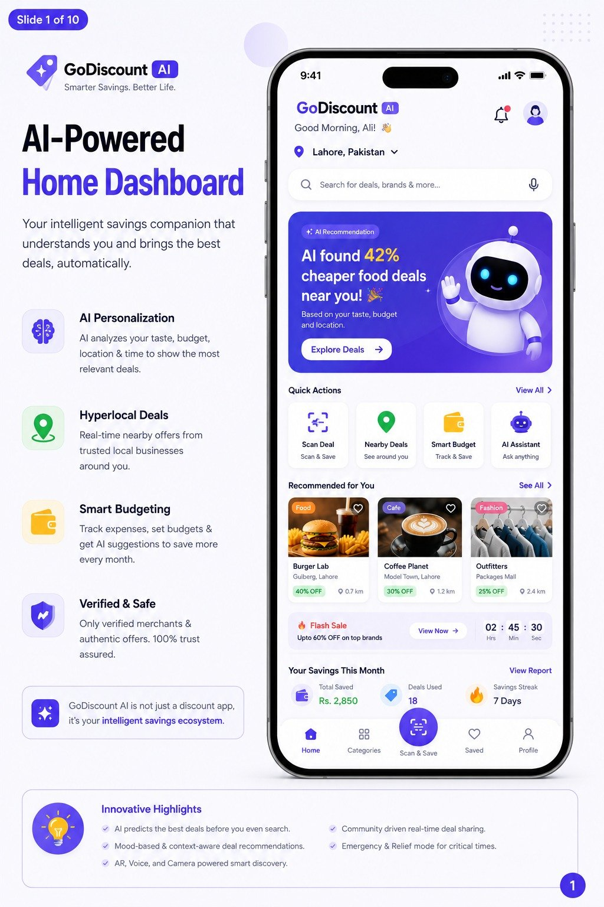
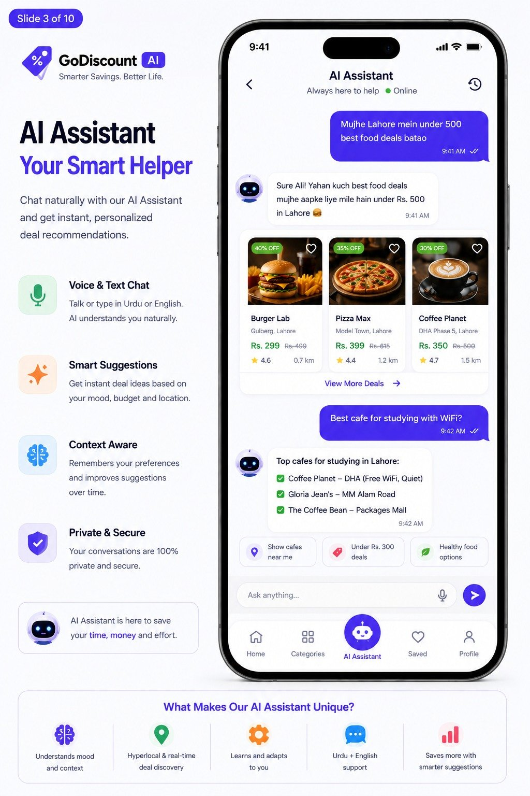
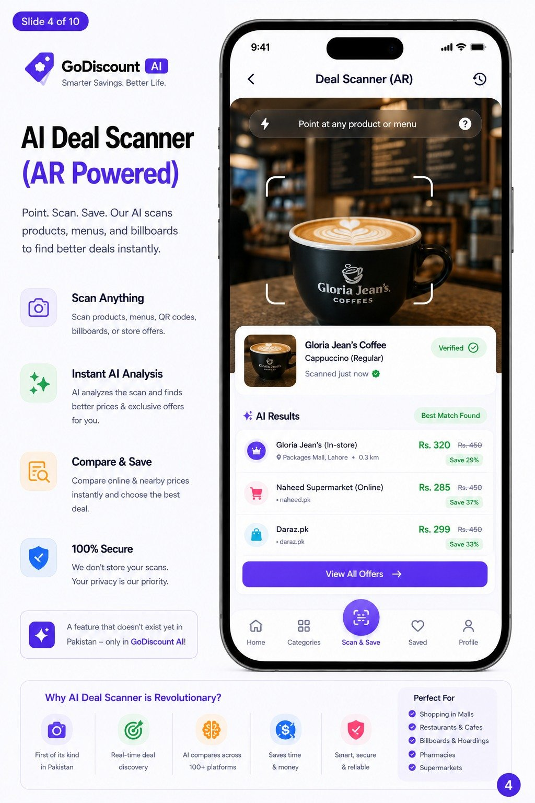
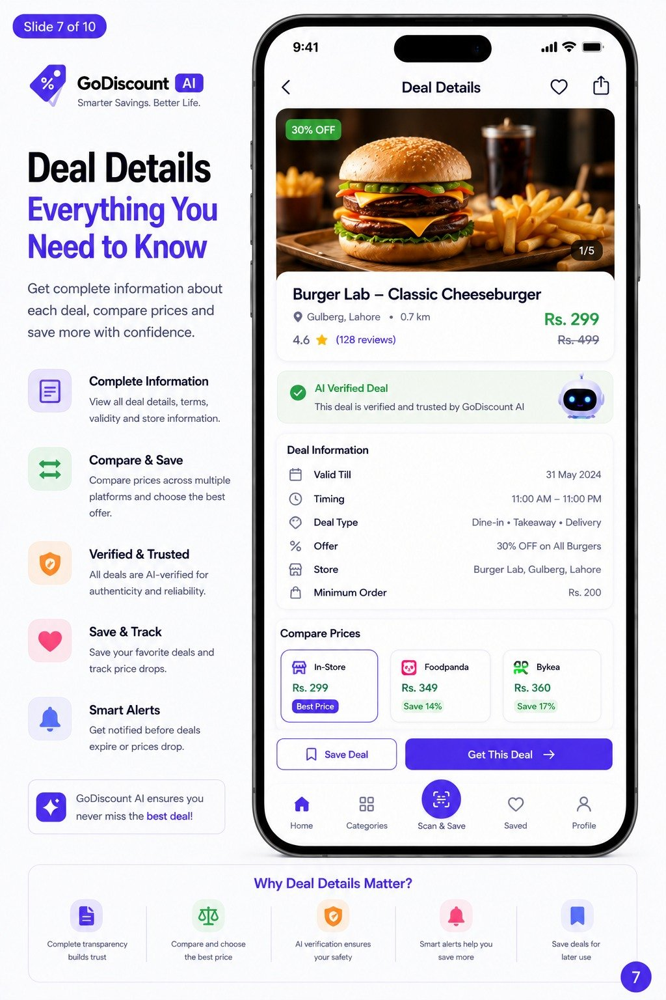
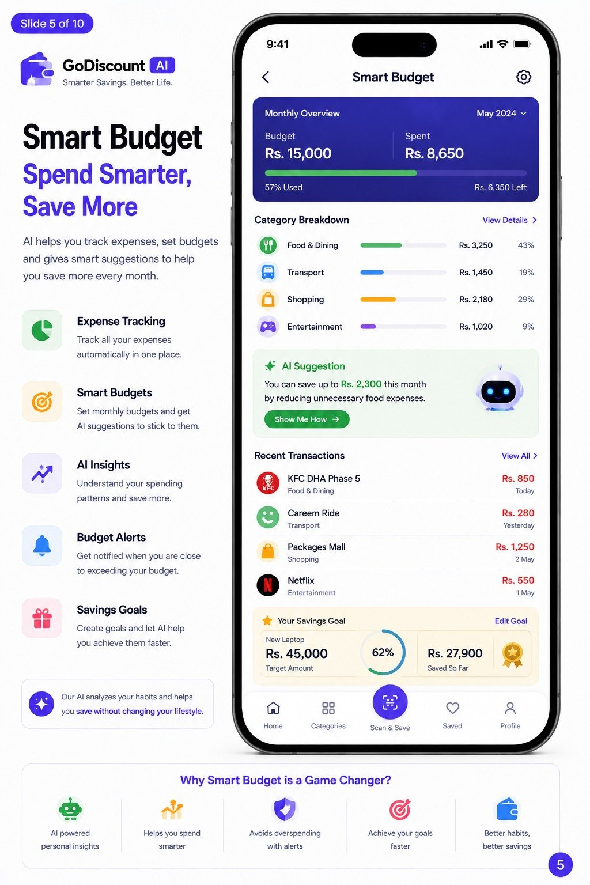
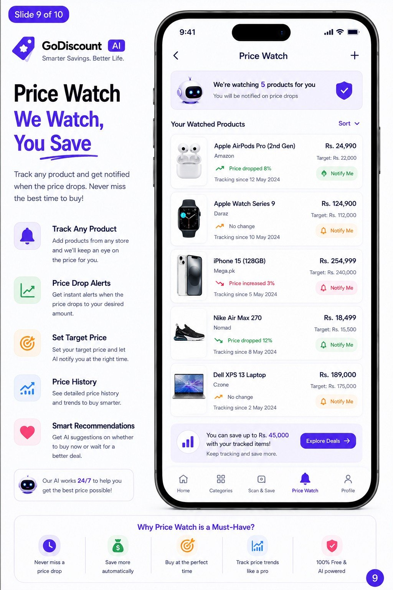
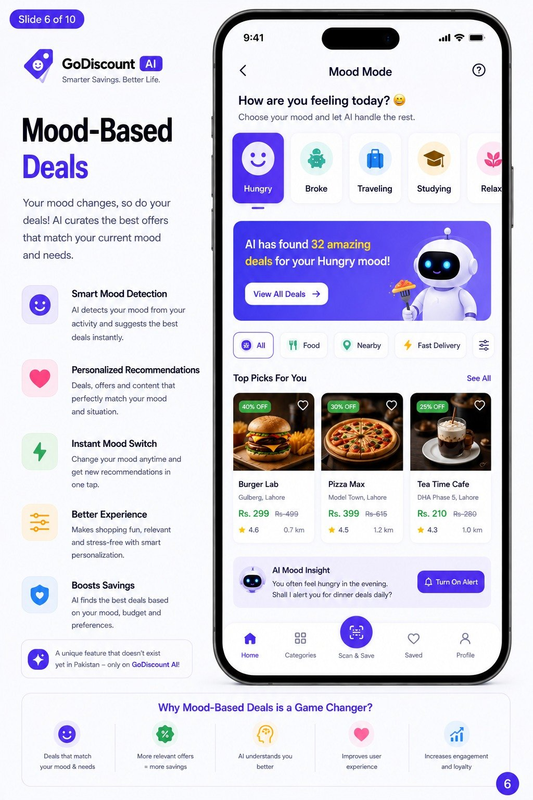
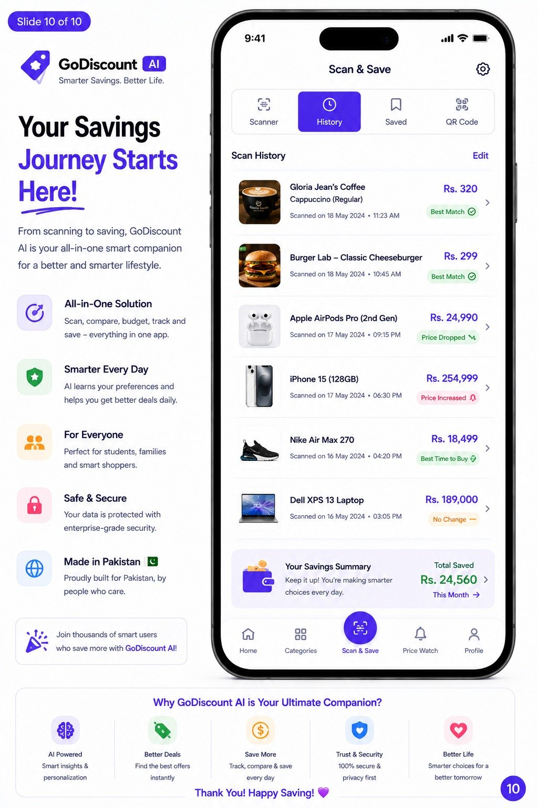
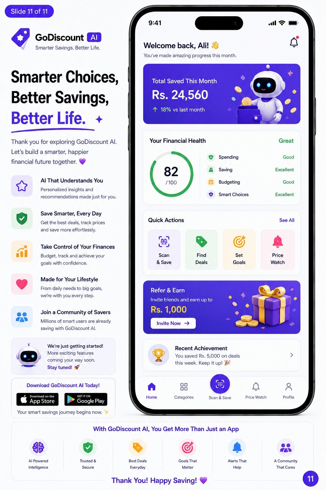

# GoDiscount AI

**Smarter Savings. Better Life.**

A university project concept for an AI-powered deals and discount app for Pakistan. GoDiscount AI recommends nearby deals based on taste, budget and location, scans products and menus to compare prices across stores and delivery apps, and helps users track spending and savings.

Developed for the Innovation and Entrepreneurship course, BS Cybersecurity, University of Management and Technology (UMT), Lahore.

> Academic project. GoDiscount AI is a concept and prototype, not a released or publicly available app. Brand names, prices and deals shown are illustrative.

## **1. Try the Prototype**

[`prototype/index.html`](prototype/index.html) is a clickable 3-screen wireframe of the Golden Path. Download it and open it in any browser, then tap through the screens.

**Golden Path:** Home Dashboard → Scan & Save → Deal Details

| Screen | User Goal | Key Action |
|---|---|---|
| Home Dashboard | Discover AI-curated deals nearby | Tap Scan Deal or a deal card |
| Scan & Save (AR) | Scan a product to compare prices | Tap View All Offers |
| Deal Details | Review the deal and redeem it | Tap Get This Deal |

The design reasoning is documented in [`docs/UX_RATIONALE.md`](docs/UX_RATIONALE.md).

## **2. Screens**

| | | |
|---|---|---|
|  |  |  |
| **AI-Powered Home** | **AI Assistant** | **AR Deal Scanner** |
|  |  |  |
| **Deal Details** | **Smart Budget** | **Price Watch** |
|  |  |  |
| **Mood-Based Deals** | **Scan and Save History** | **Summary** |

## **3. Key Features**

- **AI recommendations:** personalised deals based on taste, budget and location
- **AR deal scanner:** point the camera at a product or menu to compare prices across nearby stores and delivery apps
- **AI assistant:** chat in English or Urdu to find deals ("burger deals under 500 near me")
- **Smart budget:** expense tracking, category breakdown and budget alerts
- **Price watch:** track products and get notified when prices drop
- **Mood-based deals:** recommendations that adapt to how the user is feeling
- **AI-verified deals:** deals checked for authenticity before they are shown

## **4. Repository Contents**

```
prototype/index.html     clickable 3-screen Golden Path wireframe
docs/UX_RATIONALE.md     golden path and layout reasoning
screens/                 high-fidelity concept screens
```

## **5. Planned Implementation Stack**

| Layer | Technology |
|---|---|
| Mobile app | Flutter |
| State management | Riverpod |
| Navigation | GoRouter |
| Backend | Firebase (Auth, Firestore, Storage) |
| Architecture | MVVM |

## **6. Author**

**Moeez Hashmi**, BS Cybersecurity, UMT Lahore
